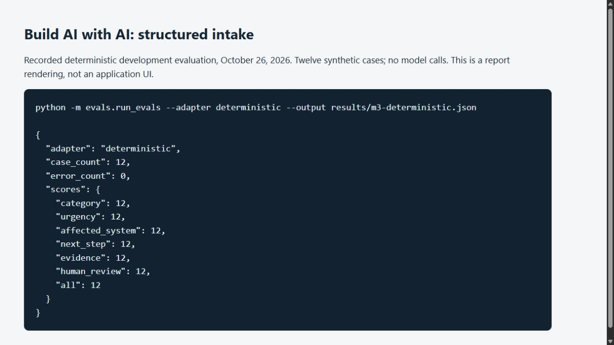

# Build AI with AI in Your Home Lab — Companion Projects

This repository contains the four runnable reference projects for *Build AI with AI in Your Home Lab* by Saurabh Chase. The projects form a capability ladder: bounded extraction, private retrieval, read-only model-selected observations, and a non-executing change proposal.

The examples are deliberately small. They use synthetic fixtures, closed schemas, deterministic policy, visible failure behavior, and disposable deployment targets. None of the applications can repair a service, run an arbitrary command, or silently apply a production change.

[Read the book on Amazon](https://www.amazon.com/dp/B0HKGGXJCF).



This is a rendering of actual deterministic development-evaluation output from Windows and CPython 3.12.14 on October 26, 2026, not an application UI or model result. All twelve fixed development cases matched their rubric in this run. Other model and holdout observations remain in [evidence and reproduction](docs/evidence-and-reproduction.md).

## Projects

| Project | Model-owned choice | Application-owned boundary | Explicitly absent |
|---|---|---|---|
| [1. Intake service](project-1-intake-service/) | Extract three bounded facts | Validation, urgency, evidence request, next step | Diagnostic or change access |
| [2. Runbook assistant](project-2-runbook-assistant/) | Synthesize from retrieved passages | Corpus integrity, retrieval, abstention, citation allowlist | Tools and actions |
| [3. Read-only diagnostic agent](project-3-readonly-diagnostic-agent/) | Select approved observations and summarize them | Service scope, tool schema, budgets, evidence IDs | Repair, shell, and arbitrary paths |
| [4. Sandboxed change planner](project-4-sandboxed-change-planner/) | Select typed desired values | Before-values, diff, validation, risks, rollback, approval status | Apply, deploy, approval, and rollback execution |

## Start safely

1. Read [prerequisites](docs/prerequisites.md) and [model-provider configuration](docs/model-provider.md).
2. Run the deterministic software tests before connecting a model.
3. Use only the included synthetic fixtures and a disposable environment.
4. Run development evals before holdout evals. Once you inspect a holdout result, treat that set as previously viewed.
5. Preserve failed results under a local `results/` directory; it is ignored by Git.
6. Keep the applications loopback-only unless you add and test a real authentication, authorization, TLS, logging, and operating model.

Example test command from any project directory:

```text
docker build --target test -t build-ai-home-lab-test .
docker run --rm build-ai-home-lab-test
```

The recorded behavioral evidence used [NVIDIA Nemotron 3.5 Lightning 30B-A3B BF16](https://huggingface.co/nvidia/NVIDIA-Nemotron-3.5-Lightning-30B-A3B-BF16) behind an OpenAI-compatible endpoint. The software boundary is provider-portable, but another model, server, prompt, or decoding configuration creates new evidence rather than reproducing the recorded result. Model weights are not included and remain governed by their own license; this repository's MIT License does not replace or extend the model license.

## Evidence and limits

Each project includes:

- a specification and threat model;
- deterministic tests;
- synthetic development and holdout cases;
- a reader-facing evidence summary;
- containerized test and runtime targets where applicable.

The recorded counts are small, bounded experiments—not general accuracy, security, or performance claims. See [evidence and reproduction](docs/evidence-and-reproduction.md).

## Repository status

This is the public companion repository for the book. The edition-aligned release is identified by the immutable `book-v1.0.0` tag. Reproduce the projects from that tag when following the printed edition; later commits may reflect corrections or dependency changes.

The companion code is available under the [MIT License](LICENSE). Model weights, third-party packages, and linked materials remain subject to their own terms.

The book manuscript, cover, diagrams, screenshots, review reports, and publishing files are not part of this repository.

## Choose your next project

[Start here: choose a Practical AI Home Lab book](https://github.com/chasesaurabh/give-your-home-labs-ai-a-memory/blob/codex/memory-companion/docs/start-here.md), or [browse the series on Amazon](https://www.amazon.com/dp/B0HP7F73K4). Each book can be read on its own.
